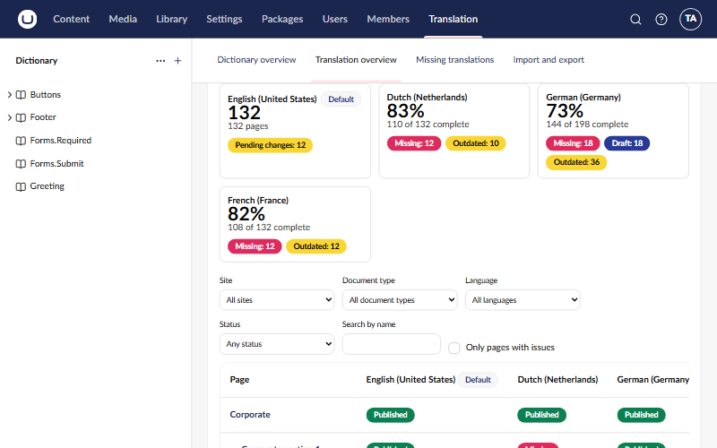

# DynamicDave.Umbraco.TranslationHealth

A site-wide translation status overview for multilingual Umbraco sites, a Translations tab on every document, and dictionary tools: a missing-translations report, CSV and XLIFF export, and import with a test run, history and undo.

The backoffice UI is localized in English, Dutch, German, French and Danish (`src/DynamicDave.Umbraco.TranslationHealth/Client/src/localization`).

Umbraco 17 and 18 backoffice package (`DynamicDave.Umbraco.TranslationHealth`). See [the package README](src/DynamicDave.Umbraco.TranslationHealth/README.md) for what it does, configuration and limitations.

## License

MIT, see [LICENSE](LICENSE).
